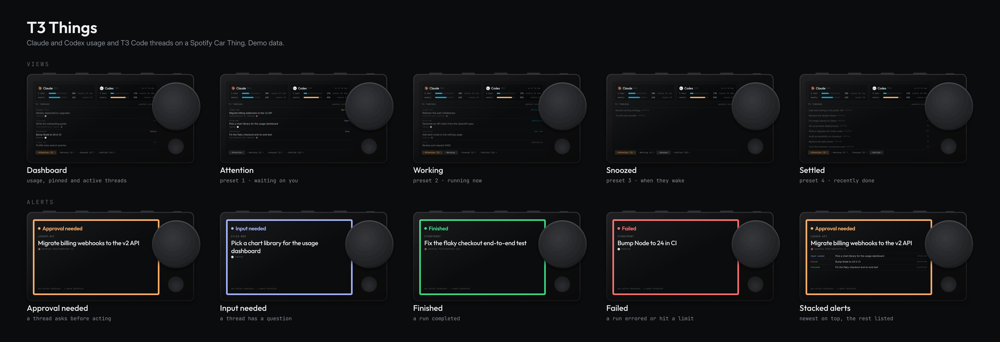
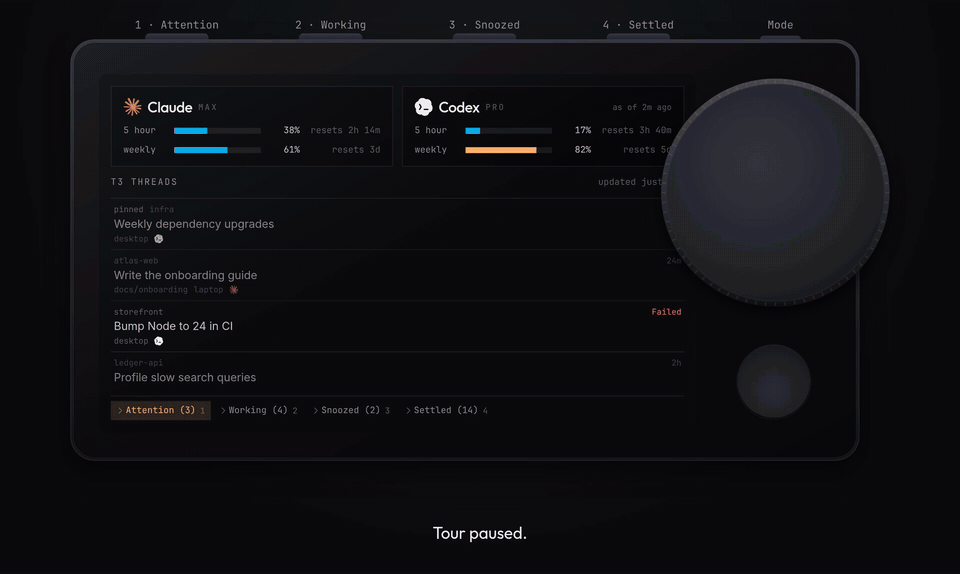

<p align="center">
  
</p>

<h1 align="center">T3 Things</h1>

<p align="center">
  Claude and Codex plan usage and your T3 Code threads on a Spotify Car Thing,<br />
  with a full-screen alert when a thread needs you.
</p>

<p align="center">
  <a href="https://snowopsdev.github.io/t3-things/demo/"><b>Try the playable demo</b></a>
</p>



<p align="center">
  
</p>

T3 Things turns a Car Thing running [bridgething](https://bridgething.com) into a small desk display for coding agents. A status service on your computer collects what's going on, and the Car Thing shows it:

- **Usage.** Claude and Codex 5-hour and weekly windows, with how much is used and when each resets.
- **Threads.** Your [T3 Code](https://github.com/pingdotgg/t3code) threads from every machine you run it on, laid out like the T3 sidebar: pinned and active threads up front, and Attention, Working, Snoozed, and Settled lists one button away.
- **Alerts.** When a thread stops for approval or input, finishes, or fails, the screen flashes in that state's color and can jump to full brightness. Alerts that land together stack up. Any button clears them.

All the screenshots, the GIF, and the demo use made-up data.

## Controls

| Control       | What it does                                    |
| ------------- | ----------------------------------------------- |
| Preset 1      | Attention: threads waiting on you, unread runs  |
| Preset 2      | Working: running now, with how long             |
| Preset 3      | Snoozed: and when each wakes up                 |
| Preset 4      | Settled: recently finished threads              |
| Back          | Close the open list                             |
| Dial          | Scroll the list                                 |
| Any button    | Dismiss an alert (preset 1 also opens Attention) |
| Tap           | Dismiss an alert                                |

## How it works

```
 T3 Code on each machine ─┐
 Claude usage ────────────┼─▶ status service ──HTTPS over Tailscale──▶ phone running ──▶ Car Thing
 Codex session logs ──────┘   (service/)                               bridgething          (apps/t3-things)
```

- **The status service** (`service/agent-status.mjs`, plain Node, no dependencies) follows each T3 Code server's live stream, reads Claude's plan usage with Claude Code's existing login, and reads Codex's rate limits from its session logs, locally and over ssh. It serves one small `status.json` behind a bearer token. It is read-only and never refreshes OAuth tokens, so it can't log out a running CLI.
- **The Car Thing app** polls that document every 5 seconds. The Car Thing has no network of its own, so bridgething sends the request through the paired phone. That means the phone has to reach the service, which is why it runs over Tailscale. iOS also refuses plain HTTP there, so the service is published over HTTPS with `tailscale serve`.

## Set it up

You need a Car Thing running bridgething, paired with the bridgething companion app on your phone; [Tailscale](https://tailscale.com) on the phone and on the computer that runs the service; Node 22 or newer; and [Bun](https://bun.sh) to build the app.

### 1. Run the status service

```sh
git clone https://github.com/snowopsdev/t3-things && cd t3-things
mkdir -p ~/.config/agent-status

# The token the Car Thing sends. Any long random string works.
openssl rand -hex 24 > ~/.config/agent-status/display.token
```

For each T3 Code host, issue a read-only session token with `t3 auth session issue --scope orchestration:read` and save it as `~/.config/agent-status/t3-<name>.token`. By default the service watches one host named `desktop` at `http://127.0.0.1:3773`. To watch more machines, or read Codex logs from them over ssh, copy [`service/config.example.json`](service/config.example.json) to `~/.config/agent-status/config.json` and edit it.

Claude usage comes from Claude Code's login in `~/.claude/.credentials.json`, and Codex usage from `~/.codex/sessions`, so sign in to both CLIs on that machine.

Start the service and publish it to your tailnet:

```sh
node service/agent-status.mjs        # or install service/agent-status.service as a systemd user unit
tailscale serve --bg --https=8449 http://127.0.0.1:8790
```

Check it from any device on the tailnet:

```sh
curl -H "Authorization: Bearer $(cat ~/.config/agent-status/display.token)" \
  https://<computer>.<tailnet>.ts.net:8449/status.json
```

### 2. Install the app

With the Car Thing connected:

```sh
bun install
bun run push
```

Then open T3 Things' settings in the bridgething companion app and enter the service URL (`https://<computer>.<tailnet>.ts.net:8449`) and the display token. The same page has switches for attention alerts, finished and failed alerts, and the brightness boost. To build those defaults into the app instead, put `VITE_AGENT_STATUS_URL` and `VITE_AGENT_STATUS_TOKEN` in `apps/t3-things/.env.local`, which git ignores.

## Develop

Run these from `apps/t3-things`:

```sh
bun run dev                # develop against a connected bridgething instance
bun run dev:device         # show the dev server on the Car Thing
bun run push               # build and install on the device
bun run typecheck

bun run demo               # the playable demo, locally
bun run build:demo         # the demo as a static site in dist-demo/
bun run screenshots:frame  # frame docs/screenshots and rebuild the overview grid
```

Add `?demo` to the app's URL to run it on made-up data, with no device or service needed. In demo mode the console has `t3things.testAlert('approval')` and `t3things.demo.advance()`, which plays the next scripted thread change.

Pushing to `main` builds the app into the bridgething catalog at `https://snowopsdev.github.io/t3-things/catalog.v1.json` and deploys the playable demo next to it.

```
apps/t3-things/
  src/          the Car Thing app (React, Tailwind)
  settings/     the settings page shown in the companion app
  demo/         the playable demo page
  docs/         screenshots, the demo GIF, and the device frame
service/        the status service, a systemd unit, and an example config
```

## Credits

Built on [bridgething](https://bridgething.com), which makes the Car Thing run web apps again. Thanks to [T3 Code](https://github.com/pingdotgg/t3code) by [Ping](https://github.com/pingdotgg), the app whose threads this mirrors: the thread states and the live stream come straight from it, and its sidebar is the model for the threads view. Fonts are Inter and Outfit, under the SIL Open Font License.

T3 Things isn't affiliated with Spotify, Anthropic, OpenAI, or the makers of T3 Code. Car Thing is a Spotify product, and the device frame in these docs is an original drawing. Claude's usage numbers come from an endpoint Claude Code uses that isn't publicly documented, so that part may break without notice.

## License

[MIT](LICENSE)
